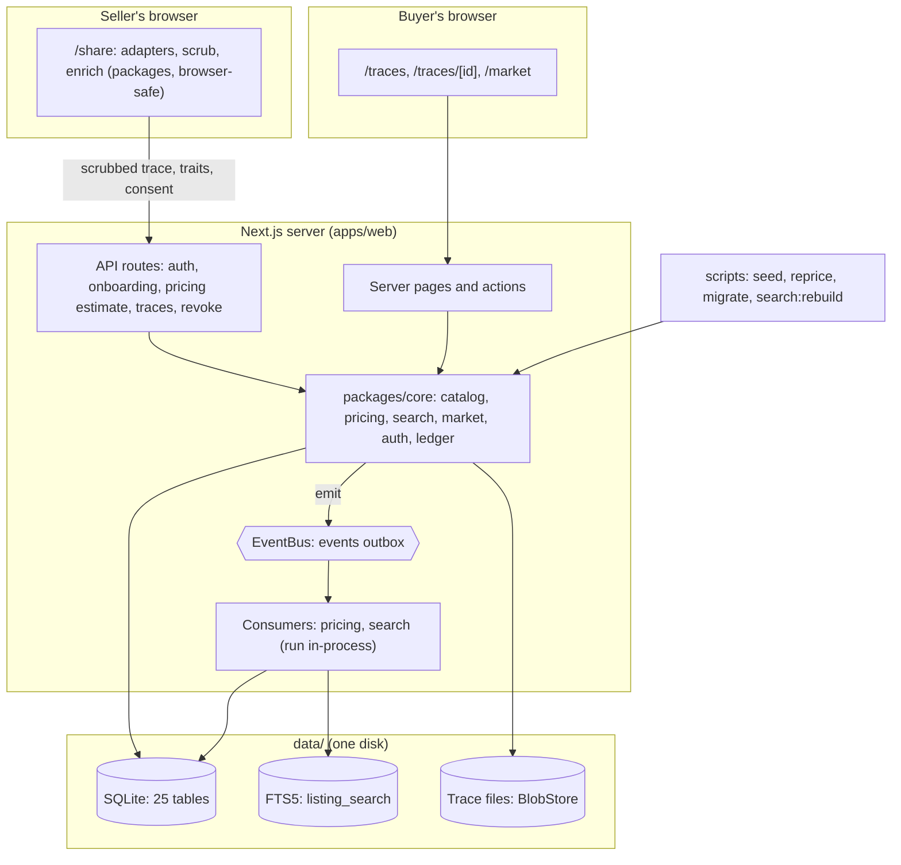

# Architecture

The full architecture write-up (decisions with alternatives, data model,
target-state component diagram, pricing model, build plan) lives in the shared
design doc: <https://claude.ai/code/artifact/1f5bb9d5-5350-47fe-a083-e7daea467704>.
This file summarises what the code implements.

## Principles

1. Raw traces never leave the seller's machine. Scrubbing and review happen
   on-device (in the browser for the v0 demo, in the CLI later).
2. Consent is explicit, per session or repo, and recorded in an append-only ledger.
3. Store once, sell many ways: Trace → derived Assets → Listings.
4. Mocks sit behind real interfaces (`packages/core/src/ports.ts`).
5. Local first: one command, no cloud account.

## How the code maps to the design

| Design decision                                     | Where it lives                                                     |
| --------------------------------------------------- | ------------------------------------------------------------------ |
| D1 Harness adapters as plugins                      | `packages/adapters` (`TraceAdapter`, registry)                     |
| D2/D3 On-device layered scrubbing                   | `packages/scrub` (`ScrubStage`), browser-safe                      |
| D4 Trace → Asset → Listing                          | `packages/db/src/schema.ts` (`traces`, `assets`, `listings`)       |
| D5 Tiered sharing                                   | `packages/schema` (`Tier`), `packages/core/src/policy`             |
| D6 Rebuildable search index                         | `SearchIndex` port in `packages/core/src/ports.ts`                 |
| D7 Collections are queries; purchases are snapshots | `collections`, `collection_snapshots` tables                       |
| D8 Pluggable pricing                                | `packages/pricing` (`PricingPolicy`), weights in `packages/config` |
| D9 Double-entry ledger and entitlements             | `packages/core/src/ledger`, `ledger_*`, `entitlements` tables      |
| D10 Vendor model with bounty board                  | `bounties`, `bounty_submissions` tables                            |
| D11 Everything emits events                         | `packages/core/src/events` (outbox table, per-consumer cursors)    |

## As built (v0)

One Next.js process does everything; the seller's browser does the parsing,
scrubbing and labelling. Dashed boxes are the interfaces where production
services plug in ([SERVICES.md](SERVICES.md)).

The target-state diagram (separate services, queue, object storage,
warehouse) is in the design doc. What changes on the way there is in
[DEPLOYING.md](DEPLOYING.md#path-to-production).

## Data conventions

- IDs are prefixed random strings (`trc_…`, `ltx_…`).
- Money is integer cents. Each order line stores the seller share in force.
- Timestamps are integer milliseconds.
- The trace schema is versioned (`schemaVersion: 1`); adapters target it.

## Milestones

| #   | Milestone                                                  | Status  |
| --- | ---------------------------------------------------------- | ------- |
| M0  | Scaffold: monorepo, config, all tables, events, ledger, CI | Done    |
| M1  | Canonical schema + Claude Code adapter                     | Done    |
| M2  | Scrubber + labeler + trait extractor                       | Done    |
| M3  | Pricing engine                                             | Done    |
| M4  | Onboarding + sharing                                       | Done    |
| M5  | Catalog + trace viewer                                     | Done    |
| M6  | Market simulator + seed data + failure lab                 | Done    |
| M7  | Docs, deployment (Docker)                                  | Done    |
| M8  | Rehearse, polish, end-to-end test                          | This PR |

## Session log adapters

`packages/adapters` turns a harness's native log into the canonical trace.
The Claude Code adapter reads `~/.claude/projects/<project>/<session>.jsonl`:

- One trace per session id in the file; the trace id is a hash of the session
  id, so the raw id and the working directory never leave the parser.
- User text, assistant text, tool calls and tool results become events, in
  order. Tool results carry `isError`, which is also set when the user rejects
  a tool call. Interrupts are flagged on the user message.
- Slash commands, local command output and compaction become `system` events.
  Messages Claude Code writes itself (model `<synthetic>`, e.g. API error
  notices) become `system` events of kind `harness_message`, not model output.
- Title: the latest `ai-title` line, else the first `summary` line.
- Token usage is totalled once per model response (Claude Code repeats it on
  every line of a multi-part response) into `trace.metrics`.
- Meta lines, sub-agent (sidechain) turns, thinking blocks, bookkeeping system
  lines (`turn_duration`, `away_summary`) and other line types (`attachment`,
  `api-request*`, `cost-state`, `mode`, ...) are skipped and counted; malformed
  lines become warnings. Parsing never throws.
- Checked against real Claude Code 2.1.300 logs.
- Tool output over 20,000 characters is truncated.

The format is not a stable public contract, so the parser reads fields
defensively. `pnpm inspect:sessions <folder>` parses real files locally and
prints structure only (counts, tools, errors), never message content.

## Scrubbing (`packages/scrub`)

`scrubTrace(trace, { customTerms })` returns a scrubbed copy plus a list of
redactions (kind, event, length; never the removed text). It walks every text
field, including nested tool-call input and the title. Stages run in order:

| Stage               | Catches                                                                                                                                                              | Replacement                                    |
| ------------------- | -------------------------------------------------------------------------------------------------------------------------------------------------------------------- | ---------------------------------------------- |
| secrets (always on) | Private keys; Anthropic, OpenAI, Stripe, GitHub, Slack, Google and AWS keys; JWTs; bearer tokens; credentials in URLs; `KEY=value` where the name says it's a secret | `[REDACTED:<kind>]`, keeping the variable name |
| pii                 | Emails (not `example.com` / GitHub noreply), Luhn-valid card numbers, phone numbers, public IP addresses                                                             | `[REDACTED:<kind>]`                            |
| paths               | Account names in `/Users/…`, `/home/…`, `C:\Users\…`                                                                                                                 | `<user>`, keeping the path shape               |
| hosts               | `*.internal`, `*.corp`, `*.local`, `*.lan`, `*.intranet`, `*.private`                                                                                                | `[REDACTED:internal_host]`                     |
| custom              | Terms the seller adds (their name, company, codename), whole words                                                                                                   | `[REDACTED:custom_term]`                       |

Scrubbing is idempotent and never re-redacts a placeholder. `stats.density`
(share of characters redacted) feeds the pricing quality factor. The rules
favour precision on code (`process.env.X`, type annotations and template
placeholders are left alone); the seller's review screen (M4) is the final check.

## Labels and traits (`packages/enrich`)

`enrichTrace(scrubbedTrace, { redactionDensity })` returns heuristic labels,
pricing traits and the rarity combo key, in one pass, browser-safe.

| Label                                                   | Kind    | Rule                                                                                   |
| ------------------------------------------------------- | ------- | -------------------------------------------------------------------------------------- |
| `test_tampering`                                        | failure | Edit to a test file that removes assertions                                            |
| `retry_loop`                                            | failure | Same tool fails 3+ times in a row                                                      |
| `user_correction`                                       | failure | User message after agent activity that starts with "no", "don't", "that's wrong", …    |
| `tool_rejected`                                         | failure | User rejected a proposed tool call                                                     |
| `user_interrupt`                                        | failure | User interrupted the agent                                                             |
| `tool_error`                                            | failure | Any other tool error                                                                   |
| `harness_error`                                         | failure | API error notices from the harness (not counted as an agent failure)                   |
| `tests_passed_at_end` / `tests_failed_at_end`           | outcome | Result of the last test command                                                        |
| `recovered` / `unresolved`                              | outcome | After a failure: tests pass at the end, or the agent finishes with a successful action |
| `context_compaction`, `long_session`, `no_model_output` | signal  | As named                                                                               |

The primary failure category (first of the failure codes above, in that
order) goes into the combo key `language|framework|failure|model` used for
rarity. Language comes from edited file extensions, then build commands;
framework needs two mentions. A preference pair is a correction or
rejection that the agent then acts on.

## Accounts, onboarding and sharing (M4)

**Flow:** sign up (email, password, role) → onboarding (data terms, versioned
as `TERMS_VERSION`) → `/share` → `/me/traces`.

**What runs where**

| Step                                        | Runs in                           | Code                                           |
| ------------------------------------------- | --------------------------------- | ---------------------------------------------- |
| Read `.jsonl` files, detect adapter, parse  | Browser                           | `@tm/adapters`                                 |
| Scrub (plus the seller's own words to hide) | Browser                           | `@tm/scrub`                                    |
| Labels and traits                           | Browser                           | `@tm/enrich`                                   |
| Price estimate                              | Server, from **traits only**      | `POST /api/pricing/estimate` → `estimatePrice` |
| Strip content for signals only              | Browser, then again on the server | `toSignalsOnly`                                |
| Store, label, list, price                   | Server                            | `POST /api/traces` → `shareTrace`              |

**The server never trusts an upload.** `shareTrace` validates the schema,
scrubs again, strips content again for signals only, recomputes labels and
traits (for signals only, browser-reported traits are bounded by what the
server can see), computes redaction density from the placeholders left in the
text, refuses sessions with no model output, synthetic uploads, duplicates and
sellers who haven't accepted the current terms, then writes the trace, consent,
asset, labels, traits and listing in one transaction and reprices.

**Accounts.** Passwords are hashed with scrypt. The session cookie holds a
random token; the database stores only its SHA-256 hash. Sessions last 7 days.
Buyer accounts get a buyer organisation.

**Withdrawing** sets `consents.revoked_at`, delists the listing, emits
`consent.revoked` and `listing.delisted`, and reprices. The same session can
be shared again later.

## Catalog and viewer (M5)

**Catalog (`/traces`)**: server-rendered, works without JavaScript. Free-text
search, filters (what went wrong, outcome, language, framework, model, shared
as, source), sorting (highest price, rarest, newest, lowest price, best
match) and pagination. Facet counts for each filter ignore that filter's own
selection, so buyers see what switching it would give.

**Search** (`packages/core/src/search`): SQLite FTS5 table `listing_search`
behind the `SearchIndex` port, ranked by bm25 (title weighted 3×). Each
listing has three columns: `title`; `meta` (stack, model, labels, tools); and
`content` (message text and commands, open-source listings only). Signals-only
content is never indexed. Content follows the same rule as the viewer:
signed-in searches match all three columns, anonymous searches only title and
`meta` (`includeContent`, off by default). A `search` event consumer indexes on
`listing.created` and removes on `listing.delisted`; `rebuildSearchIndex`
recreates it from the database and blobs, and `ensureSearchIndex` does so
automatically when the index and the active listings disagree.

**Viewer (`/traces/[id]`)**: what went wrong (labels linked to the events
that triggered them, which are highlighted in the timeline), key numbers,
the session timeline, and a price card with a license switch (research,
evaluation, training) and the "why this price" breakdown.

**Content policy** (`canViewContent`): the owner always sees their trace;
signed-in users see open-source traces in full; anonymous visitors and
signals-only listings get structure only. `getListingDetail` strips content
before returning, so pages can't leak it by accident.

**Demand from browsing**: a signed-in buyer's search with filters records a
`search` demand signal (weight 0.2) and a trace view records a `view`
signal (0.05) for its language and failure type; prices reprice
immediately. Weights are in `pricing.demand.signalWeights`.

## Market simulator, seed data and failure lab (M6)

**Synthetic generator (`packages/synth`)**: a seeded generator (mulberry32,
so the same seed gives the same catalog) that writes canonical traces for a
weighted mix of stacks, from common (TypeScript/React, Python) to rare
(COBOL, Verilog, Haskell), and failure patterns (retry loop, test tampering,
user correction, tool rejected, interrupt, tool error, clean). Traces are
built so the real `enrich` labelers detect the intended pattern, which the
tests check. Every generated trace has provenance `synthetic`; the public
share API rejects synthetic traces, and only internal callers
(`shareTrace(…, { allowSynthetic: true })`) can list them.

**Seed (`pnpm seed`)**: 200 traces from 9 sellers, replayed week by week
over the last 9 weeks. Each week lists that week's sessions, adds a few buyer
searches and reprices, so every listing starts with a real price history
rather than a single point. Demo logins: `seller@example.com`,
`buyer@example.com` (password `demo-password`).

**Market simulator (`/market`, `packages/core/src/market`)**: for a chosen
language and failure type, a signed-in user can:

- **post a bounty**: stored in `bounties` and recorded as a `bounty` demand
  signal with weight = budget in dollars × `bountyWeightPerDollar`; matching
  prices rise, most where supply is scarce;
- **add supply**: generate N synthetic sessions of that kind, owned by the
  simulator account; the combination becomes common and rarity pulls prices
  down;
- **reset**: close bounties, delete bounty demand and withdraw every
  simulator listing, which returns prices to where they were.

The watch list follows the four most valuable matching listings, excluding
simulator supply so the same listings stay in view, and draws each price
history as a small multiple on one shared price scale, with changes evenly
spaced so recent moves are visible next to weeks of history. The trace
viewer has the same chart at full size, on a time axis, with a table view.

**Failure lab (`demo/failure-lab`)**: four small Node and Python projects
whose tests fail as shipped, each with the prompt to give the agent and what
to watch for: test tampering, a retry loop on a flaky test, a scripted user
correction, and a scripted tool rejection and interrupt. Sessions from them
are shared through the normal flow and marked _staged_.
